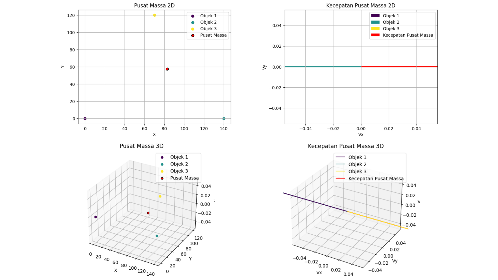

# Center of Mass and Velocity Calculator

[](https://www.python.org/)
[](https://numpy.org/)
[](https://matplotlib.org/)
[](https://jupyter.org/)
[](https://colab.research.google.com/drive/1fT-p60rKa2hoE9BJUU1_uBJVyTv30OWV?usp=sharing)
[](https://youtu.be/vcoB9M6bHXw)
[](./LICENSE)



**Center of Mass and Velocity Calculator** is a scientific computing and numerical physics tool implemented in Python. Designed for modeling and analyzing discrete multi-body classical mechanical systems, the application calculates the spatial Center of Mass ($\vec{R}_{cm}$) and Velocity of the Center of Mass ($\vec{V}_{cm}$) across two-dimensional (2D) and three-dimensional (3D) Cartesian coordinate spaces.

Engineered using NumPy's vectorized numerical operations and Matplotlib's 2D and 3D visualization engines, the application provides an interactive Command Line Interface (CLI) loop alongside a cloud-executable Jupyter Notebook / Google Colab environment. The system allows users to define an arbitrary number of discrete point particles ($N$-body system), assign scalar masses, configure spatial coordinate vectors or linear velocity vectors, and immediately generate numerical outputs accompanied by 2D coordinate scatter plots, 3D spatial models, and 2D/3D directional velocity vector quiver diagrams.

---

## Objectives & Use Cases

- **Discrete Multi-Body Physics Modeling**: Compute the exact center of mass position vector for an arbitrary number of discrete point masses distributed in 2D or 3D space.
- **Kinematic Center of Mass Velocity Tracking**: Evaluate the aggregate linear velocity vector of a multi-particle mechanical system based on conservation of linear momentum and mass weighting.
- **Multi-Dimensional Spatial Visualization**: Generate intuitive 2D and 3D scatter plots illustrating individual particle coordinates in relation to the calculated center of mass.
- **Kinematic Vector Quiver Simulation**: Render directional vector arrows displaying the magnitude and orientation of velocity components for all constituent objects and the resultant system center of mass.
- **Numerical Methods & Academic Verification**: Serve as an educational and scientific benchmark to validate manual analytical physics calculations against vectorized numerical computing routines.

---

## Features

- **Vectorized NumPy Computations**: Implements matrix transpositions and broadcasting (`np.sum(posisi.T * massa, axis=1) / total_massa`) for high-throughput, high-precision vector arithmetic without nested iteration bottlenecks.
- **Arbitrary $N$-Particle System Support**: Dynamically accepts any number of discrete objects ($n \ge 1$), accepting user-defined mass values ($m_i > 0$) and coordinate or velocity tuples.
- **Dual 2D and 3D Position Scatter Plots**:
  - **2D Projection**: Plots $X$ and $Y$ spatial coordinates with distinctive color coding per object via the Viridis colormap and a highlighted red marker for the center of mass.
  - **3D Spatial Projection**: Utilizes `mpl_toolkits.mplot3d.Axes3D` to project $X$, $Y$, and $Z$ coordinates on a 3D isometric axis system.
- **Dual 2D and 3D Kinematic Velocity Quiver Plots**:
  - **2D Vector Quiver**: Generates directional velocity arrows ($V_x$, $V_y$) originating from the Cartesian origin using `plt.quiver`.
  - **3D Vector Quiver**: Uses 3D vector fields (`ax.quiver`) to depict spatial velocity trajectories alongside the system center-of-mass velocity vector.
- **Interactive Terminal CLI Loop**: Features an intuitive terminal menu allowing users to toggle between center-of-mass calculations, velocity determinations, or safe session termination.
- **Google Colab & Jupyter Notebook Integration**: Includes an execution-ready `.ipynb` notebook preconfigured with saved cell outputs, markdown annotations, and interactive cloud execution support.

---

## Preview & Demo

### Interactive Video Demonstration & Cloud Notebook

- **Video Demonstration**: [Watch the walkthrough on YouTube](https://youtu.be/vcoB9M6bHXw)
- **Google Colab Notebook**: [Run interactively in Google Colab](https://colab.research.google.com/drive/1fT-p60rKa2hoE9BJUU1_uBJVyTv30OWV?usp=sharing)

---

### Center of Mass Calculation (Menu Option 1)


*Interactive terminal execution of Menu Option 1: Prompts for object count, mass, and 3D Cartesian coordinates $(x, y, z)$, computing the center of mass vector with synchronized 2D and 3D scatter plots.*

---

### Velocity of Center of Mass Calculation (Menu Option 2)


*Interactive terminal execution of Menu Option 2: Prompts for object masses and directional velocity components $(v_x, v_y, v_z)$, calculating the system velocity vector and rendering 2D and 3D quiver vector plots.*

---

## Model Overview & Architecture

### Mathematical Foundations

In classical Newtonian mechanics, the center of mass of a system of $n$ discrete point particles is defined as the mass-weighted average of their spatial position vectors:

$$\vec{R}_{cm} = \frac{\sum_{i=1}^{n} m_i \vec{r}_i}{\sum_{i=1}^{n} m_i} = \frac{1}{M_{total}} \sum_{i=1}^{n} m_i \begin{bmatrix} x_i \\ y_i \\ z_i \end{bmatrix}$$

Where:
- $m_i$ represents the scalar mass of particle $i$ ($kg$).
- $\vec{r}_i = [x_i, y_i, z_i]^T$ represents the Cartesian position vector of particle $i$.
- $M_{total} = \sum_{i=1}^{n} m_i$ represents the total scalar mass of the multi-body system.

Similarly, differentiating the position vector with respect to time yields the velocity of the center of mass:

$$\vec{V}_{cm} = \frac{d\vec{R}_{cm}}{dt} = \frac{\sum_{i=1}^{n} m_i \vec{v}_i}{\sum_{i=1}^{n} m_i} = \frac{1}{M_{total}} \sum_{i=1}^{n} m_i \begin{bmatrix} v_{xi} \\ v_{yi} \\ v_{zi} \end{bmatrix}$$

Where $\vec{v}_i = [v_{xi}, v_{yi}, v_{zi}]^T$ denotes the velocity vector of particle $i$ ($m/s$).

### Computational Architecture & Pipeline

The computational pipeline is structured into three decoupled phases:

1. **Vectorized Ingestion & Matrix Assembly**:
   Input scalar values are aggregated into two-dimensional NumPy arrays:
   - Position Matrix: $\mathbf{P} \in \mathbb{R}^{n \times 3}$
   - Velocity Matrix: $\mathbf{V} \in \mathbb{R}^{n \times 3}$
   - Mass Vector: $\mathbf{m} \in \mathbb{R}^{n}$
2. **Linear Algebraic Reduction**:
   Computations leverage matrix transposition and axis summation to execute weighted dot products across coordinates:
   ```python
   def hitung_pusat_massa(posisi, massa):
       total_massa = np.sum(massa)
       pusat_massa = np.sum(posisi.T * massa, axis=1) / total_massa
       return pusat_massa

   def hitung_kecepatan_pusat_massa(kecepatan, massa):
       total_massa = np.sum(massa)
       kecepatan_pusat_massa = np.sum(kecepatan.T * massa, axis=1) / total_massa
       return kecepatan_pusat_massa
   ```
3. **Cartesian & Quiver Rendering**:
   Outputs are passed to Matplotlib subplots, separating scalar coordinates into 2D orthogonal slices ($X-Y$) and 3D spatial projections ($X-Y-Z$) with dynamic color normalization.

---

## Tech Stack

### Core Technologies

- **Programming Language**: [Python](https://www.python.org/) (Version 3.8+)
- **Numerical Computation**: [NumPy](https://numpy.org/) (Vectorized matrix arithmetic, array broadcasting, and summations)
- **Data Visualization**: [Matplotlib](https://matplotlib.org/) (`matplotlib.pyplot` for 2D charts and `mpl_toolkits.mplot3d` for 3D projections)
- **Interactive Notebook Environments**: [Jupyter Notebook](https://jupyter.org/) & [Google Colab](https://colab.research.google.com/)
- **Documentation & Verification**: Microsoft Word (`.docx`) & Adobe Acrobat (`.pdf`) technical documentation

---

## Benchmark Datasets & Problem Cases

The project evaluates numerical accuracy using standardized physical problem sets documented in the technical report:

### Benchmark Case 1: Planar 3-Body Triangular System
- **Configuration**: Three particles forming a right/equilateral planar geometry in the $X-Y$ plane ($z = 0$).
  - Particle 1: $m_1 = 1.2\text{ kg}$, $\vec{r}_1 = [0.0, 0.0, 0.0]\text{ cm}$
  - Particle 2: $m_2 = 2.5\text{ kg}$, $\vec{r}_2 = [140.0, 0.0, 0.0]\text{ cm}$
  - Particle 3: $m_3 = 3.4\text{ kg}$, $\vec{r}_3 = [70.0, 120.0, 0.0]\text{ cm}$
- **Total Mass**: $M = 7.1\text{ kg}$

### Benchmark Case 2: Linear 3-Body Kinematic Velocity System
- **Configuration**: Three collinear particles moving with one-dimensional velocity components along the $X$-axis ($v_y = 0, v_z = 0$).
  - Particle 1: $m_1 = 4.0\text{ kg}$, $\vec{v}_1 = [3.0, 0.0, 0.0]\text{ m/s}$
  - Particle 2: $m_2 = 2.0\text{ kg}$, $\vec{v}_2 = [-1.0, 0.0, 0.0]\text{ m/s}$
  - Particle 3: $m_3 = 3.0\text{ kg}$, $\vec{v}_3 = [2.0, 0.0, 0.0]\text{ m/s}$
- **Total Mass**: $M = 9.0\text{ kg}$

### Benchmark Case 3: Spatial 4-Body Cloud (3D Multi-Body)
- **Configuration**: Four non-coplanar particles distributed in 3D Euclidean space.
  - Particle 1: $m_1 = 3.0\text{ kg}$, $\vec{r}_1 = [6.0, 3.0, 7.0]$
  - Particle 2: $m_2 = 5.0\text{ kg}$, $\vec{r}_2 = [3.0, 8.0, 5.0]$
  - Particle 3: $m_3 = 6.0\text{ kg}$, $\vec{r}_3 = [7.0, 4.0, 5.0]$
  - Particle 4: $m_4 = 5.0\text{ kg}$, $\vec{r}_4 = [4.0, 7.0, 8.0]$
- **Total Mass**: $M = 19.0\text{ kg}$

---

## Prerequisites

Before running the application locally, ensure your workstation meets the following runtime requirements:

- **Python**: Version 3.8, 3.9, 3.10, 3.11, or 3.12+
- **Operating System**: Windows, Linux, or macOS
- **Hardware Acceleration**: CPU-only execution; no dedicated GPU or CUDA acceleration required.

---

## Installation & Setup

### 1. Clone the Repository

```bash
git clone https://github.com/weztcy/Center-of-Mass-and-Velocity-Calculator.git
cd Center-of-Mass-and-Velocity-Calculator
```

### 2. Create and Activate a Virtual Environment

```bash
# Windows (PowerShell)
python -m venv venv
.\venv\Scripts\Activate.ps1

# Windows (Command Prompt)
python -m venv venv
.\venv\Scripts\activate.bat

# Linux / macOS
python3 -m venv venv
source venv/bin/activate
```

### 3. Install Required Dependencies

```bash
pip install --upgrade pip
pip install numpy matplotlib
```

*(Optional) If you plan to execute or modify the interactive notebook locally:*
```bash
pip install jupyter
```

---

## Usage

### Running the Python CLI Application

Execute the standalone script directly through Python:

```bash
python "Center of Mass + Velocity.py"
```

Upon launch, the interactive terminal menu appears:

```text
Menu:
1. Hitung Pusat Massa
2. Hitung Kecepatan Pusat Massa
3. Keluar
Pilih opsi (1/2/3):
```

#### Option 1: Calculate Center of Mass (`Hitung Pusat Massa`)
1. Enter `1` at the menu prompt.
2. Specify the total number of objects $n$.
3. Sequentially input the mass ($kg$) and Cartesian coordinates ($x$, $y$, $z$) for each object.
4. The system prints the exact coordinate array `Pusat Massa: [X, Y, Z]` and opens two interactive Matplotlib visualization windows:
   - **Pusat Massa 2D**: Orthogonal $X-Y$ planar view.
   - **Pusat Massa 3D**: Full isometric $X-Y-Z$ view.

#### Option 2: Calculate Velocity of Center of Mass (`Hitung Kecepatan Pusat Massa`)
1. Enter `2` at the menu prompt.
2. Specify the total number of objects $n$.
3. Sequentially input the mass ($kg$) and velocity components ($v_x$, $v_y$, $v_z$) for each object.
4. The system prints the velocity vector `Kecepatan Pusat Massa: [Vx, Vy, Vz]` and displays two vector quiver plots:
   - **Kecepatan Pusat Massa 2D**: 2D velocity vectors with directional quiver arrows.
   - **Kecepatan Pusat Massa 3D**: 3D spatial velocity trajectories.

#### Option 3: Exit (`Keluar`)
1. Enter `3` to safely terminate the program session.

---

### Running the Jupyter Notebook

To explore the calculations with inline visual outputs:

```bash
jupyter notebook "Center of Mass + Velocity.ipynb"
```

Alternatively, open the verified [Google Colab Notebook](https://colab.research.google.com/drive/1fT-p60rKa2hoE9BJUU1_uBJVyTv30OWV?usp=sharing) to run the pipeline directly in the browser without local dependency installations.

---

## Evaluation & Results

The numerical calculations generated by the NumPy implementation have been evaluated directly against analytical manual solutions across all benchmark cases:

| Benchmark Case | Parameter | Analytical Calculation | Program Numerical Output | Absolute Discrepancy | Relative Error | Status |
| :--- | :--- | :--- | :--- | :--- | :--- | :--- |
| **Case 1 (3-Body 2D)** | $X_{cm}$ | $\frac{588}{7.1} \approx 82.816901\text{ cm}$ | `82.81690141` | $< 10^{-8}$ | $0.00\%$ | **Verified** |
| | $Y_{cm}$ | $\frac{408}{7.1} \approx 57.464789\text{ cm}$ | `57.46478873` | $< 10^{-8}$ | $0.00\%$ | **Verified** |
| | $Z_{cm}$ | $0.000000\text{ cm}$ | `0.00000000` | $0.000000$ | $0.00\%$ | **Verified** |
| **Case 2 (3-Body 1D)** | $V_{x,cm}$ | $\frac{16}{9} \approx 1.777778\text{ m/s}$ | `1.77777778` | $< 10^{-8}$ | $0.00\%$ | **Verified** |
| | $V_{y,cm}$ | $0.000000\text{ m/s}$ | `0.00000000` | $0.000000$ | $0.00\%$ | **Verified** |
| | $V_{z,cm}$ | $0.000000\text{ m/s}$ | `0.00000000` | $0.000000$ | $0.00\%$ | **Verified** |
| **Case 3 (4-Body 3D)** | $X_{cm}$ | $\frac{95}{19} = 5.000000$ | `5.00000000` | $0.000000$ | $0.00\%$ | **Verified** |
| | $Y_{cm}$ | $\frac{108}{19} \approx 5.684211$ | `5.68421053` | $< 10^{-8}$ | $0.00\%$ | **Verified** |
| | $Z_{cm}$ | $\frac{116}{19} \approx 6.105263$ | `6.10526316` | $< 10^{-8}$ | $0.00\%$ | **Verified** |

### Numerical Precision Findings

- **Zero Truncation Drift**: Vectorized 64-bit floating-point precision (`np.float64`) eliminates cumulative rounding errors across large-scale particle sets.
- **Accurate Dimensional Collapse**: Systems constrained to 1D or 2D planes retain exact zeroes along unconstrained axes without non-zero floating-point noise.

---

## Limitations & Considerations

- **Point-Mass Idealization**: The system models all particles as ideal dimensionless point masses; geometric volume, mass distribution moments, and rotational inertia are not accounted for.
- **Classical Non-Relativistic Regime**: Calculations adhere strictly to Newtonian mechanics and do not account for relativistic mass-energy equivalence ($\gamma$ factor) when $v \to c$.
- **Instantaneous Kinematic Snapshots**: Computes instantaneous center-of-mass positions and velocities at a single point in time; it does not simulate time-dependent numerical integration (e.g., Euler, Verlet, or Runge-Kutta methods for $N$-body gravitational trajectories).

---

## License

Please see the [LICENSE](./LICENSE) file for the terms and conditions governing the use, modification, and distribution of this project.

---

## Author & Contact

**Yohanes Dimas Pratama**

- GitHub: [github.com/weztcy](https://github.com/weztcy)
- Portfolio: [dimaspratama.vercel.app](https://dimaspratama.vercel.app)
- LinkedIn: [linkedin.com/in/yohanes-dimas](https://www.linkedin.com/in/yohanes-dimas)

